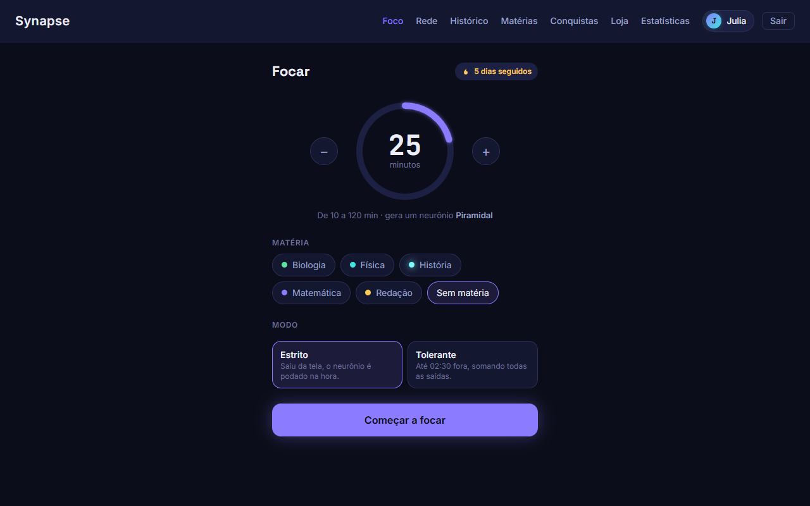
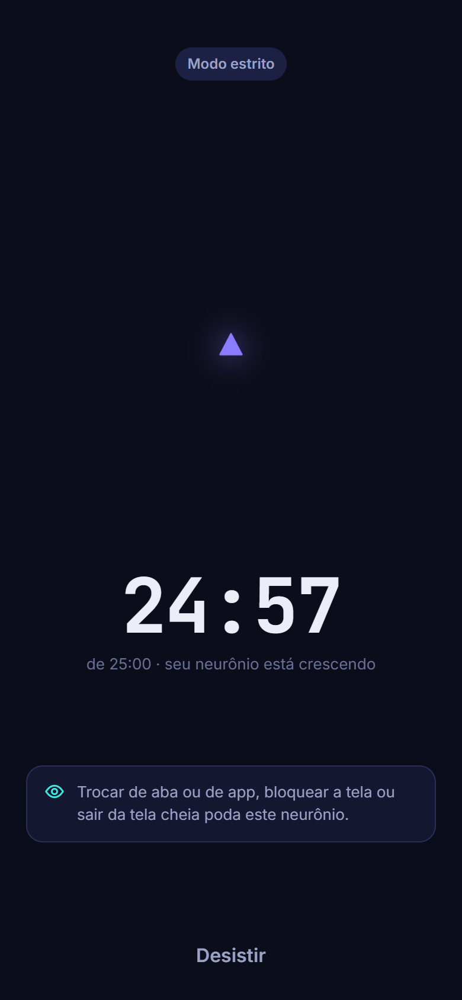
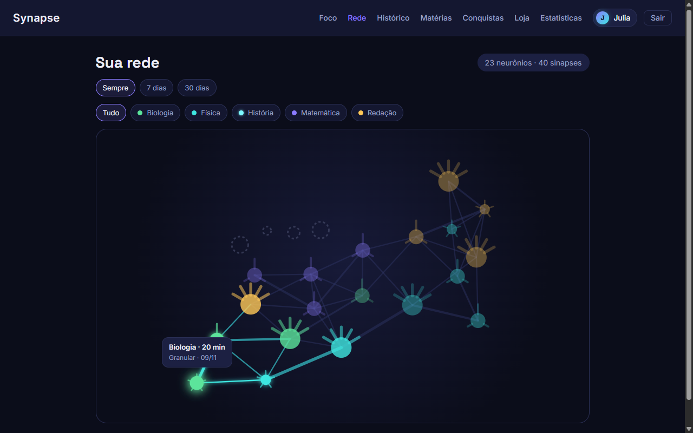
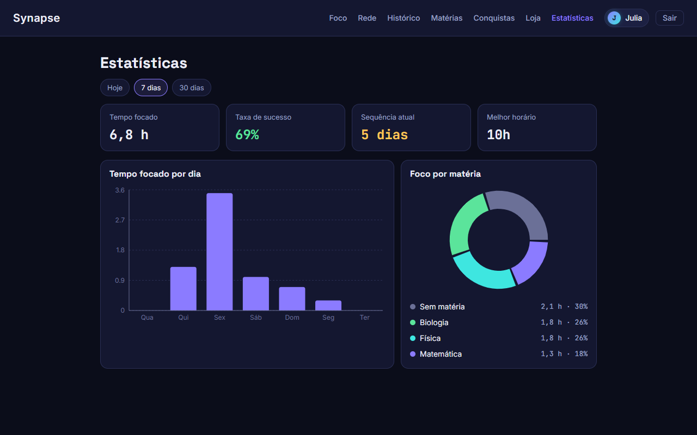
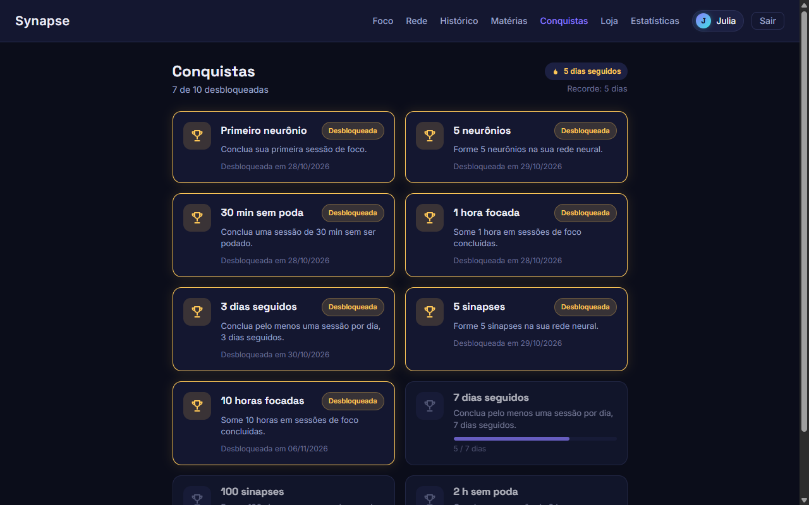
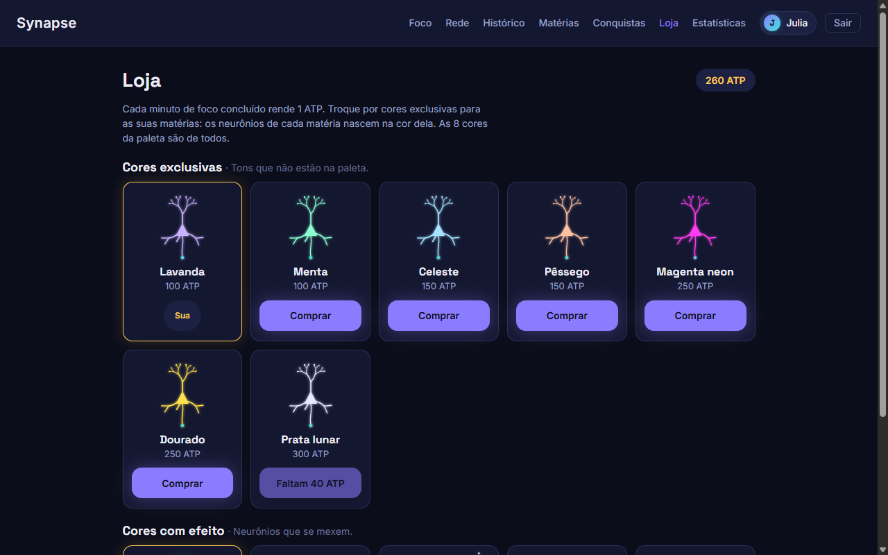

# Synapse

Aplicativo web gratuito de foco para estudantes. Cada sessão de estudo concluída vira um neurônio, e os neurônios se ligam por sinapses numa rede neural que cresce com o tempo. Sair da tela durante a sessão poda o neurônio: ele fica apagado na rede, como lembrete do foco perdido.

O Synapse foi feito para o problema do uso compulsivo do celular entre estudantes, que fragmenta a atenção e prejudica o desempenho escolar. Os dados, o público-alvo, as personas e as limitações estão em **[docs/escopo-do-problema.md](docs/escopo-do-problema.md)**.

Projeto da disciplina de Programação Orientada a Objetos. O mapa de todos os entregáveis (diagramas UML, arquitetura, relatórios e evidências) está em **[docs/README.md](docs/README.md)**.

## Acesse online

| | Endereço |
|---|---|
| App | https://synapse-web-ew1b.onrender.com |
| API: documentação (Swagger) | https://synapse-api-mnlh.onrender.com/docs/ |

Hospedado de graça no Render (frontend e API) com o banco no Neon. A API dorme depois de 15 minutos sem uso, e a primeira requisição depois disso pode levar cerca de 1 minuto. Como foi feito o deploy e por que essas escolhas: [docs/deploy.md](docs/deploy.md).

## Como funciona

1. **Escolha a duração** (de 10 a 120 minutos), a matéria e o modo, e comece a focar. A duração define a espécie do neurônio: Granular (até 24 min), Piramidal (25 a 59 min) ou Purkinje (60 min ou mais).
2. **Fique na tela.** Trocar de aba ou de app, bloquear a tela ou sair da tela cheia conta como saída. No **modo estrito**, qualquer saída poda o neurônio. No **modo tolerante**, as saídas somadas são perdoadas até 10% da duração da sessão.
3. **Termine a sessão** e o neurônio entra na sua rede. Ele se liga por sinapses aos 2 neurônios mais recentes e ao último da mesma matéria; a sinapse da matéria fica mais forte a cada volta a ela.
4. **Acompanhe o progresso**: histórico das sessões, estatísticas por dia e por matéria, sequência de dias seguidos e conquistas.
5. **Ganhe ATP** (1 por minuto focado) e troque na loja por cores novas para as suas matérias, algumas com animação.

O tempo é sempre medido pelo servidor, então mexer no relógio do aparelho não conclui a sessão antes da hora. O app funciona no celular e pode ser instalado na tela inicial (PWA).

## Telas

| Foco | Sessão em andamento (celular) |
|---|---|
|  |  |

| Rede neural | Estatísticas |
|---|---|
|  |  |

| Conquistas | Loja de cores |
|---|---|
|  |  |

As outras telas (entrar, histórico, matérias e a rede no celular) estão em [docs/prints/](docs/prints). Os prints são do app rodando localmente, com uma conta de demonstração.

## Stack

| Parte | Tecnologias |
|---|---|
| Backend | Python 3.12, Django 5.2, Django REST Framework, Simple JWT, drf-spectacular (Swagger), Argon2 para as senhas |
| Banco de dados | PostgreSQL 16 (psycopg 3) |
| Frontend | React 19, TypeScript, Vite, React Router, d3 (rede neural), Recharts (gráficos), PWA com service worker |
| Testes | pytest, pytest-django e pytest-cov no backend; Vitest e Testing Library no frontend |
| Qualidade | ruff (backend), ESLint e Prettier (frontend), GitHub Actions |
| Infraestrutura | Docker Compose (desenvolvimento), uv (dependências Python), Render e Neon (produção) |

O backend é dividido em camadas (domínio, aplicação, infraestrutura e API), com o domínio sem dependência do Django. As camadas, o fluxo de uma sessão e os padrões de projeto estão em [docs/arquitetura.md](docs/arquitetura.md).

## Como executar

A forma mais simples é com Docker: um único comando sobe o backend, o frontend e o banco, sem instalar Python nem Node na sua máquina.

### Requisitos

- [Docker Desktop](https://www.docker.com/products/docker-desktop/) instalado e **aberto** (espere aparecer "Engine running").
- Git.

### Subir o ambiente

```bash
git clone https://github.com/LuMaPro/Synapse.git
cd Synapse
docker compose up --build
```

A primeira vez demora, porque o Docker baixa as imagens e instala as dependências. Nas próximas, é bem mais rápido (e o `--build` só é necessário quando as dependências mudam). As migrações do banco rodam sozinhas quando o backend sobe.

Depois, abra http://localhost:5173 e crie uma conta.

### Endereços

| Serviço | Endereço |
|---|---|
| Frontend (React) | http://localhost:5173 |
| API: health check | http://localhost:8000/health |
| API: documentação (Swagger) | http://localhost:8000/docs/ |
| Django Admin | http://localhost:8000/admin/ |
| PostgreSQL | `localhost:5432` |

### Hot reload

As pastas `backend/` e `frontend/` são montadas dentro dos contêineres. Ao salvar um arquivo, o servidor recarrega sozinho, sem precisar reiniciar o Docker.

### Comandos úteis

```bash
docker compose up -d            # sobe em segundo plano
docker compose logs -f backend  # acompanha os logs de um serviço
docker compose down             # para e remove os contêineres
docker compose down -v          # idem, e apaga os dados do banco
```

### Problemas comuns

- **`failed to connect to the docker API`**: o Docker Desktop não está aberto. Abra-o e espere o "Engine running".
- **Porta já em uso (5173, 8000 ou 5432)**: feche o programa que está usando a porta ou pare outro `docker compose` que esteja rodando.
- **Mudei dependências e nada mudou**: rode `docker compose up --build` de novo.

### Rodar sem Docker (manual)

Requisitos: Python 3.12 com [uv](https://docs.astral.sh/uv/getting-started/installation/), Node.js 22 ou mais novo e um PostgreSQL 16 (pode ser só o banco no Docker, como abaixo).

Backend, num terminal:

```bash
cd backend
uv sync
cp .env.example .env
docker run -d --name synapse-postgres -e POSTGRES_USER=synapse -e POSTGRES_PASSWORD=synapse -e POSTGRES_DB=synapse -p 5432:5432 postgres:16
uv run python manage.py migrate
uv run python manage.py runserver
```

No Windows (PowerShell), troque o `cp` por `Copy-Item`. O `.env` copiado já funciona em desenvolvimento; antes de usar de verdade, troque o `SECRET_KEY` por uma chave sua (o `backend/README.md` mostra como gerar).

Frontend, em outro terminal:

```bash
cd frontend
npm install
npm run dev
```

Os detalhes (variáveis de ambiente, Django Admin, comandos de manutenção e a instalação como app no celular) estão em [backend/README.md](backend/README.md) e [frontend/README.md](frontend/README.md).

## Como rodar os testes

Com o ambiente do Docker no ar:

```bash
docker compose exec backend uv run pytest
docker compose exec frontend npm test
```

Sem Docker, com o PostgreSQL rodando:

```bash
cd backend
uv run pytest
```

```bash
cd frontend
npm test
```

O backend tem testes unitários do domínio e dos serviços (com repositórios em memória, sem banco) e testes de integração da API com o banco. Os testes do backend criam um banco separado (`test_synapse`) e o apagam no fim, sem mexer nos seus dados. O frontend testa telas, componentes e hooks com Vitest e Testing Library.

Para ver a cobertura, que precisa ficar acima de 80% no domínio e na aplicação do backend e no frontend:

```bash
cd backend
uv run pytest --cov=app --cov-report=html
uv run coverage report --include="app/domain/*,app/application/*" --fail-under=80
```

```bash
cd frontend
npm run test:coverage
```

O CI (GitHub Actions) roda a cada push e pull request: lint, testes com a meta de cobertura, checagem de migrações, build do frontend e build da imagem de produção. Os números da cobertura e os prints dos relatórios estão em [docs/relatorios/evidencias/](docs/relatorios/evidencias/README.md).

## Equipe

| Nome | GitHub |
|---|---|
| Bernardo Pereira | [BernardoPerS](https://github.com/BernardoPerS) |
| Fernando Takara | [ferTakara](https://github.com/ferTakara) |
| Leonardo César | [LeooCesar](https://github.com/LeooCesar) |
| Lucas Martins | [LuMaPro](https://github.com/LuMaPro) |
| Nattan Ferreira | [nattan447](https://github.com/nattan447) |
