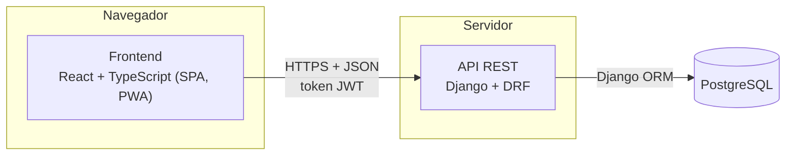
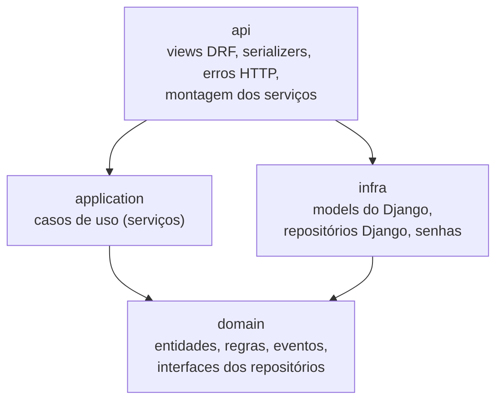
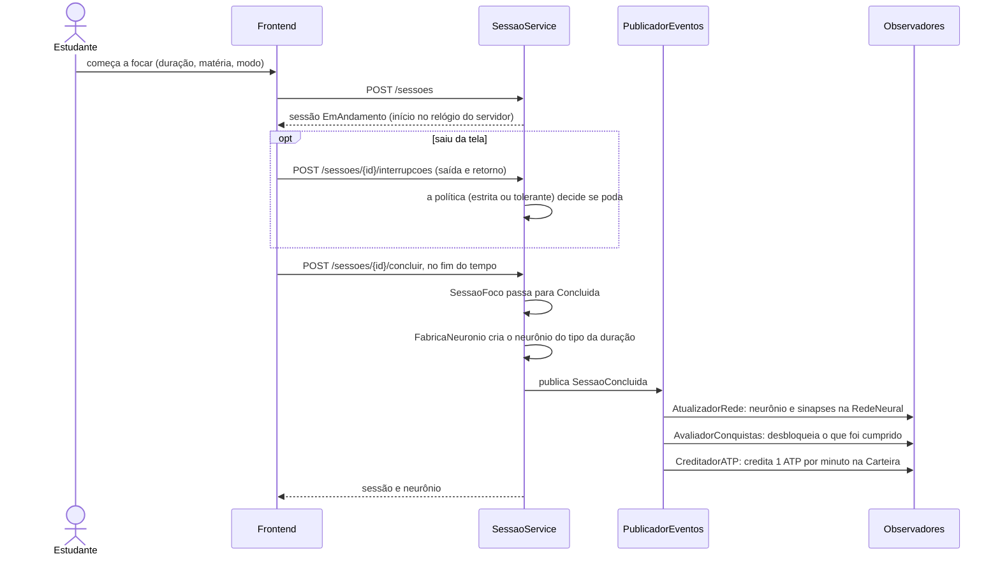

# Arquitetura do Synapse

Como o sistema foi construído de fato, na versão 1.0.0. As classes, com atributos e métodos, estão no [diagrama de classes](uml/classes-visao-geral.png) (fonte em [uml/classes.puml](uml/classes.puml)). Um teste automático (`backend/tests/unit/test_diagrama_classes.py`) confere o diagrama contra o código.

## Visão geral



- **Frontend**: uma SPA em React que roda no navegador (computador ou celular) e pode ser instalada como app. Mede o tempo na tela, detecta quando o estudante sai dela e desenha a rede neural.
- **API**: Django REST Framework. É a fonte da verdade: guarda as sessões, decide quando um neurônio é podado e mede o tempo pelo próprio relógio, não pelo do aparelho.
- **Banco**: PostgreSQL 16.

Em produção, frontend e API ficam no Render e o banco no Neon ([deploy.md](deploy.md)). Em desenvolvimento, o Docker Compose sobe os três serviços ([README](../README.md#como-executar)).

## Backend em camadas



As setas são as dependências: cada camada só conhece as de baixo, e o domínio não conhece ninguém.

| Camada | Pasta | O que tem |
|---|---|---|
| Domínio | `backend/app/domain/` | As regras de negócio em Python puro: `SessaoFoco`, `Neuronio`, `RedeNeural`, `Carteira`, as políticas de interrupção, as regras de conquista, os eventos, as exceções e as **interfaces** dos repositórios. Um teste (`tests/unit/domain/test_dominio_puro.py`) falha se algum arquivo daqui importar `django` ou `rest_framework`. |
| Aplicação | `backend/app/application/` | Um serviço por caso de uso (`SessaoService`, `RedeNeuralService`, `MateriaService`, `ConquistaService`, `LojaService`, `EstatisticasService`, `CadastroUsuario`). Recebem os repositórios e o relógio pelo construtor, então os testes unitários usam repositórios em memória e um relógio controlado. |
| Infraestrutura | `backend/app/infra/` | Os models do Django (`modelos/`), as implementações dos repositórios com o ORM (`repositorios/`) e o serviço de senhas com Argon2 (`senhas.py`). Os repositórios convertem model em entidade e vice-versa, e o domínio nunca vê um model. |
| API | `backend/app/api/` | As views do DRF, os serializers e o tradutor de erros (`erros.py`), que transforma cada exceção do domínio no código HTTP certo (404, 409 ou 422) num lugar só. É aqui que cada serviço é montado com os repositórios Django e os observadores. |

### Endpoints

| Rota | O que faz |
|---|---|
| `POST /auth/cadastro`, `POST /auth/login`, `POST /auth/renovar`, `GET /me` | Conta e autenticação |
| `POST /sessoes`, `GET /sessoes` | Inicia uma sessão; histórico paginado com filtros |
| `GET /sessoes/ativa` | Sessão em andamento (para retomar depois de recarregar a página) |
| `POST /sessoes/{id}/interrupcoes`, `/concluir`, `/desistir` | Saída da tela, conclusão e desistência |
| `GET /rede` | Neurônios e sinapses, com filtro de período e matéria |
| `GET/POST /materias`, `GET/PATCH/DELETE /materias/{id}` | Matérias do estudante |
| `GET /estatisticas` | Tempo focado, taxa de sucesso e gráficos do dia, da semana ou do mês |
| `GET /conquistas` | Conquistas e sequência de dias |
| `GET /loja`, `POST /loja/{codigo}/comprar` | Saldo de ATP e cores |
| `GET /health` | Health check usado pelo Render e pelo workflow que mantém a API acordada |

O contrato completo, com exemplos, está no Swagger (`/docs/`), gerado pelo drf-spectacular a partir do código.

### Autenticação

Login por e-mail e senha, com tokens JWT (Simple JWT): o de acesso vale 15 minutos e o de renovação, 7 dias. O frontend guarda os tokens no `localStorage` e, quando a API responde 401, renova o token uma vez e repete a requisição. As senhas são guardadas com Argon2.

## Fluxo de uma sessão de foco



- **Estado da sessão (State)**: `SessaoFoco` delega as transições ao estado atual (`EmAndamento`, `Concluida` ou `Podada`). Uma sessão concluída ou podada recusa qualquer mudança, sem `if` espalhado pela classe.
- **Saída da tela (Strategy)**: o frontend (`useDeteccaoSaida`) percebe a troca de aba ou de app, o bloqueio da tela e a saída da tela cheia, e avisa a API com os horários de saída e de volta, já convertidos para o relógio do servidor. Se a rede cair, os avisos ficam numa fila no navegador e são reenviados. Quem decide se a sessão é podada é a política no servidor: `ModoEstrito` poda na primeira saída; `ModoTolerante` perdoa até 10% da duração, somando todas as saídas.
- **Tempo no servidor**: o início, o fim e a conclusão usam o relógio do servidor, com 2 segundos de tolerância. Mexer no relógio do aparelho não encerra a sessão antes da hora.
- **Desistir**: poda o neurônio. Uma sessão podada (por desistência ou por saída da tela) com menos de 5 minutos de foco é apagada: não entra no histórico nem na rede.
- **Sessões abandonadas**: uma sessão em andamento há mais de duração + 5 minutos é podada. A API faz isso sempre que a sessão é acessada (ao abrir o app, o histórico ou as estatísticas). O comando `manage.py podar_sessoes_orfas` poda também as que ninguém acessou. Em produção ele não está agendado: a poda ao acessar já cobre tudo o que o estudante vê.
- **Eventos (Observer)**: o `SessaoService` só publica `SessaoConcluida` ou `SessaoPodada`; não sabe que a rede, as conquistas e a loja existem. Cada uma é um observador, inscrito na montagem do serviço (`app/api/sessoes.py`). A ordem importa: as conquistas são avaliadas depois que a rede já recebeu o neurônio novo.

## A rede neural e a carteira (agregados)

`RedeNeural` e `Carteira` são agregados: a única forma de mudar a rede ou o saldo é pelos métodos deles, que garantem as regras.

- **Rede**: uma sinapse só liga dois neurônios vivos do mesmo estudante, sem repetir o par. A regra de quem se liga a quem é uma estratégia trocável (`RegraFormacaoSinapses`); a atual é `RegraRecentesEMesmaMateria`. O repositório carrega a rede inteira do estudante e grava só os neurônios e as sinapses novos.
- **Carteira**: o saldo de ATP nunca fica negativo e cada cor se compra uma vez só. O repositório carrega a carteira com `SELECT ... FOR UPDATE` quando ela vai mudar, e a API roda cada caso de uso numa transação. Assim, duas compras ao mesmo tempo não gastam o mesmo ATP duas vezes.

## Persistência

| Model (`app/infra/modelos/`) | Entidade do domínio |
|---|---|
| `UsuarioModel` (usuário do Django, login por e-mail, id UUID) | `Usuario` |
| `SessaoFocoModel` e `InterrupcaoModel` | `SessaoFoco` e `Interrupcao` |
| `NeuronioModel` e `SinapseModel` | `Neuronio`, `Sinapse` e `RedeNeural` |
| `MateriaModel` | `Materia` |
| `ConquistaModel` | `ConquistaDesbloqueada` |
| `CarteiraModel` e `CorDesbloqueadaModel` | `Carteira` |

As migrações ficam em `backend/app/migrations/`, e o CI falha se um model mudar sem migração.

## Padrões de projeto

| Padrão | Onde | Para quê |
|---|---|---|
| State | `EstadoSessao` e subclasses (`domain/entidades/sessao_foco.py`) | Ciclo de vida da sessão |
| Strategy | `PoliticaInterrupcao` (`domain/politica_interrupcao.py`) e `RegraFormacaoSinapses` (`domain/formacao_sinapses.py`) | Modo estrito ou tolerante; regra de formação das sinapses |
| Factory Method | `FabricaNeuronio` e `TipoNeuronio` (`domain/entidades/neuronio.py`) | Espécie do neurônio pela duração |
| Observer | `PublicadorEventos` e `ObservadorSessao` (`domain/eventos.py`, `domain/observadores.py`) | Rede, conquistas e ATP reagem ao fim da sessão |
| Repository | Interfaces em `domain/repositorios.py`, implementações em `infra/repositorios/` | Domínio sem ORM; testes com repositórios em memória |
| Template Method | `RegraConquista` e subclasses (`domain/conquistas.py`) | Cada conquista só define o que medir |
| Agregado (DDD) | `RedeNeural`, `Carteira` | Regras que envolvem vários objetos ao mesmo tempo |

O problema que cada padrão resolveu, as alternativas descartadas e os trade-offs estão em [relatorios/padroes-de-projeto.md](relatorios/padroes-de-projeto.md).

## Frontend

```
frontend/src/
├── pages/       # uma tela por rota: Login, Cadastro, Foco, Rede, Historico,
│                # Materias, Conquistas, Loja, Estatisticas
├── components/  # Layout, GrafoRede, NeuronioAnimado, SeletorDuracao, ...
├── hooks/       # useSessaoFoco (timer e ciclo da sessão), useDeteccaoSaida,
│                # useTelaLigada, useMaterias, useConquistas, useAuth
├── contexts/    # AuthContext: usuário logado e tokens
├── services/    # chamadas à API, uma por recurso (sessoes.ts, rede.ts, ...)
├── utils/       # funções puras: tempo, geometria do neurônio, histórico
└── styles/      # CSS de cada tela
```

- **Rotas**: React Router. Todas as telas, menos entrar e cadastrar, ficam atrás de `RotaProtegida`, que manda para o login quem não tem token.
- **Rede neural**: as posições dos neurônios saem de uma simulação de forças (`d3-force`, em `utils/redeNeural.ts`), e o `GrafoRede` desenha o SVG com o React. O zoom e o arrasto (`d3-zoom`) mudam só a transformação de um grupo, direto no DOM, sem redesenhar os neurônios.
- **Estatísticas**: gráficos com Recharts.
- **Celular**: abaixo de 640 px, a navegação vira uma barra de abas embaixo. Durante a sessão, a tela fica ligada (Wake Lock API). O manifest e o service worker (`public/sw.js`) deixam o app instalável; a API nunca passa pelo cache.

## Testes e integração contínua

| Nível | Onde | Ferramentas |
|---|---|---|
| Unitário (domínio e serviços) | `backend/tests/unit/` | pytest, repositórios em memória |
| Integração (API e banco) | `backend/tests/integration/` | pytest-django, cliente do DRF, PostgreSQL |
| Componentes, telas e hooks | `frontend/src/**/*.test.ts(x)` | Vitest, Testing Library, servidor falso da API |

O GitHub Actions (`.github/workflows/ci.yml`) roda a cada push e pull request: ruff, `manage.py check`, checagem de migrações, testes do backend com cobertura mínima de 80% no domínio e na aplicação, ESLint, testes do frontend com cobertura mínima de 80% e build. Também monta a imagem de produção e roda `check --deploy`. A estratégia está em [relatorios/testes.md](relatorios/testes.md) e as evidências em [relatorios/evidencias/](relatorios/evidencias/README.md).

## O que ficou para depois

Estas ideias estão planejadas no marco v1.1.0 (Extras) e não fazem parte da versão 1.0.0:

- extensão de navegador para bloquear sites durante a sessão;
- foco em grupo (sinapse coletiva);
- lembretes de estudo e notificações;
- revisão de acessibilidade;
- alternar entre modo escuro e claro (hoje o app só tem o tema escuro).

Também ficou de fora uma decisão de projeto: a interface `RepositorioNeuronio` tem implementação, mas nenhum serviço a usa, porque os neurônios são gravados junto com a rede pelo `RepositorioRedeNeural`.
