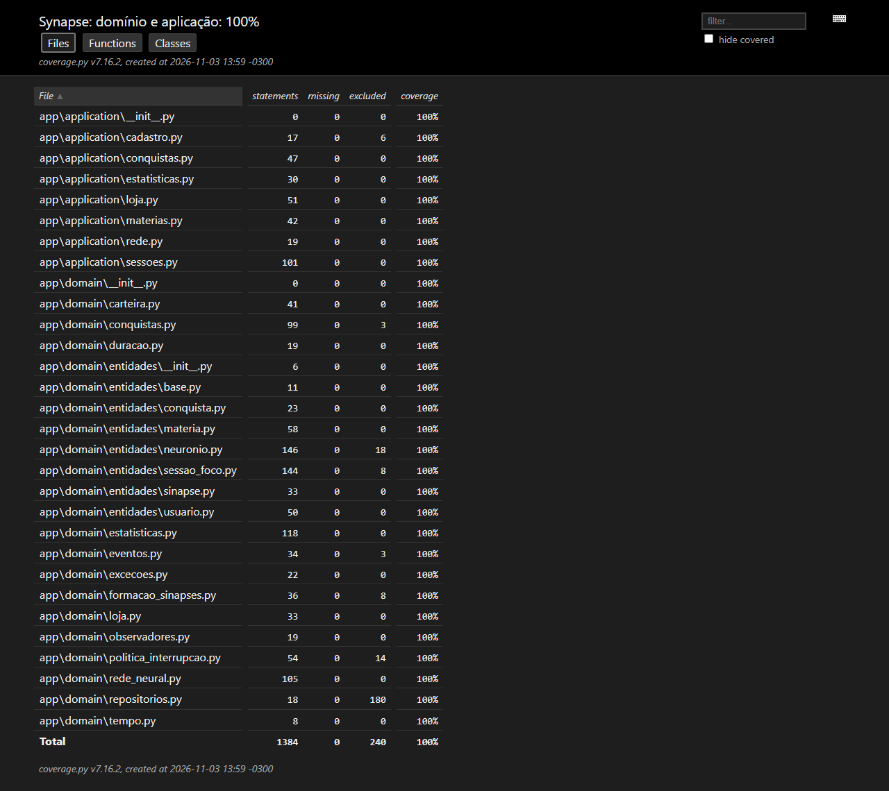
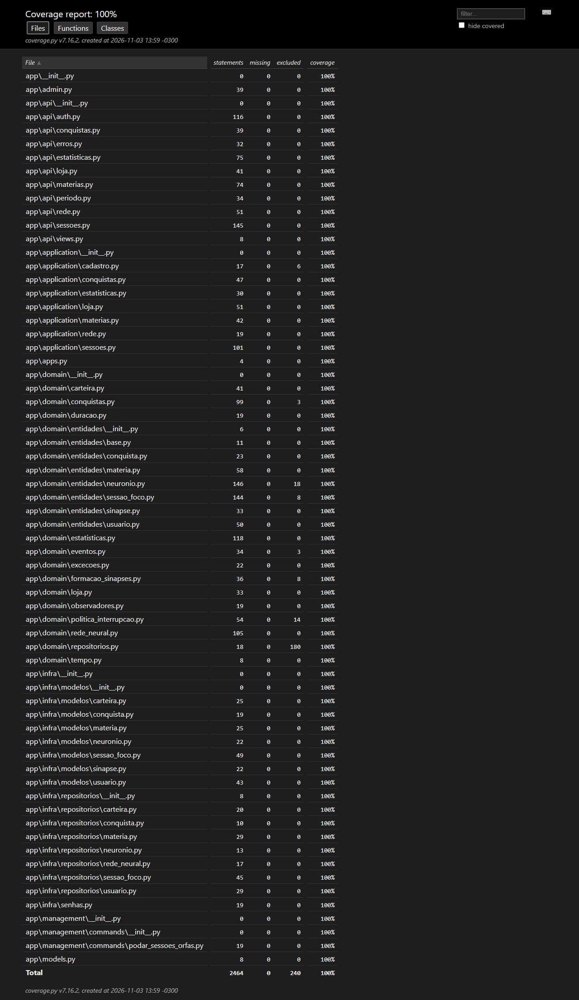
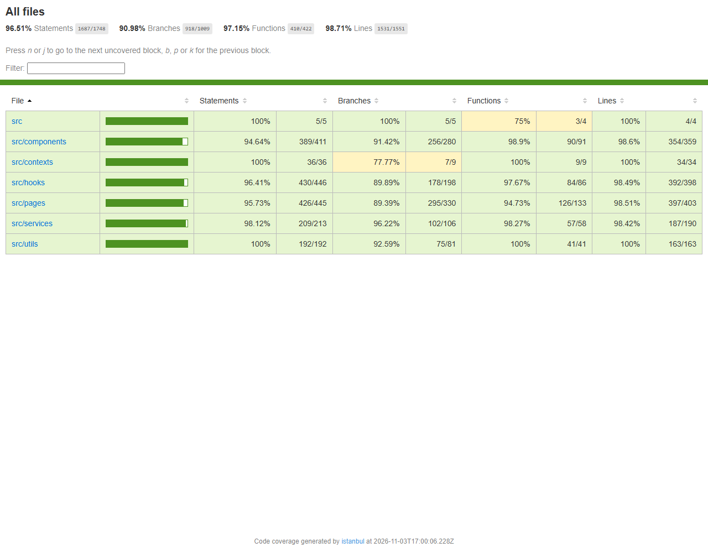
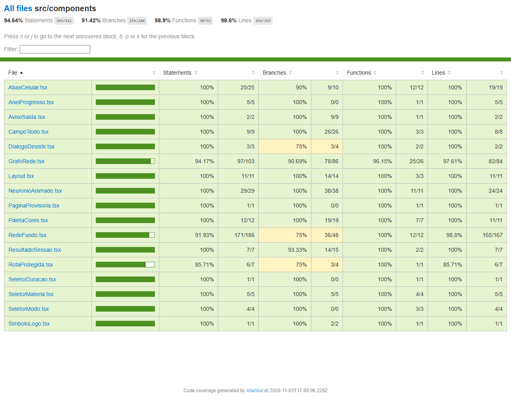

# Evidências: cobertura de testes (issue #43)

Medido em 03/11/2026, na `main` com as mudanças da issue #43. A meta é **pelo menos 80%** em `app/domain` e `app/application`; o CI confere a meta a cada PR, no backend e no frontend.

## Resumo

### Backend (pytest + pytest-cov 7 / coverage.py 7.16)

747 testes, todos passando.

| Camada | Instruções | Sem cobertura | Cobertura |
|---|---:|---:|---:|
| `app/domain` | 1077 | 0 | **100%** |
| `app/application` | 307 | 0 | **100%** |
| `app` inteiro (inclui `api` e `infra`) | 2464 | 0 | **100%** |

As migrações ficam de fora da conta, porque são geradas pelo Django. Os métodos abstratos (`@abstractmethod`) também ficam de fora: só definem o contrato das interfaces (repositórios, `ObservadorSessao`, tipos de neurônio, políticas de interrupção, regras de formação) e não têm corpo para testar. É a coluna *excluded* do relatório.

### Frontend (Vitest 5 + @vitest/coverage-v8)

381 testes em 36 arquivos, todos passando.

| Métrica | Coberto | Cobertura |
|---|---:|---:|
| Instruções | 1687 / 1748 | **96,51%** |
| Ramos (`if`, `?:`, `??`) | 918 / 1009 | **90,98%** |
| Funções | 410 / 422 | **97,15%** |
| Linhas | 1531 / 1551 | **98,71%** |

A conta inclui todo o código em `frontend/src`, sem os próprios testes, o servidor falso usado pelos testes (`src/test/`) e o ponto de entrada (`main.tsx`). O service worker (`public/sw.js`) tem testes próprios em `src/sw.test.ts`, mas fica fora da conta porque não está em `src/`.

## Lacunas encontradas e preenchidas

| Onde | Antes | Depois | O que faltava |
|---|---:|---:|---|
| `app/domain/eventos.py` | 97% | 100% | Corpo do método abstrato de `ObservadorSessao` (agora fora da conta, como os demais abstratos) |
| `app/api/erros.py` | 84% | 100% | Permissão negada (403), outros erros do DRF (405) e erro inesperado (500 sem expor o detalhe), em `tests/integration/test_api_erros.py` |
| `app/api/auth.py` | 92% | 100% | Cadastro com o campo `e-mail` e renovação de token com rotação ligada |
| `app/api/materias.py` | 99% | 100% | Edição com nome vazio (400) |
| `app/infra/modelos/*` | 92–98% | 100% | Texto de cada registro no Admin (`__str__`), em `tests/integration/test_modelos_str.py` |
| `app/infra/repositorios/sessao.py` | 0% | removido | Apelido antigo de `sessao_foco.py` que nenhum código importava |
| `frontend/src/hooks/useMaterias.ts` | 72% | 100% | Recarregar a lista e cada erro do servidor ao criar, editar e excluir (cor bloqueada, nome repetido, dados inválidos, sem conexão) |
| `frontend/src/components/RedeFundo.tsx` | 17% | 92% | O fundo animado das telas de login e cadastro: desenho, reação ao cursor, pausa com a aba escondida, ajuste ao tamanho da tela e limpeza ao sair, com um canvas falso |

No frontend, o que ainda falta são poucas linhas e ramos espalhados (a lista completa está no relatório HTML), como o `canvas` sem contexto 2D e a velocidade mínima dos neurônios do fundo, que o jsdom não consegue provocar. Nenhuma pasta fica abaixo de 94% das instruções.

## Prints do relatório HTML

**Backend, `app/domain` e `app/application`:**



**Backend, todos os arquivos:**



**Frontend, por pasta:**



**Frontend, componentes:**



## Como reproduzir

Backend, com o PostgreSQL rodando:

```bash
cd backend
uv run pytest --cov=app --cov-report=html
uv run coverage report --include="app/domain/*,app/application/*" --fail-under=80
```

O relatório HTML fica em `backend/htmlcov/index.html`.

Frontend:

```bash
cd frontend
npm run test:coverage
```

O relatório HTML fica em `frontend/coverage/index.html`. O comando falha se alguma métrica ficar abaixo de 80%.

No CI (`.github/workflows/ci.yml`), os dois relatórios HTML ficam nos artefatos de cada execução: `coverage-html` (backend) e `coverage-html-frontend`.
