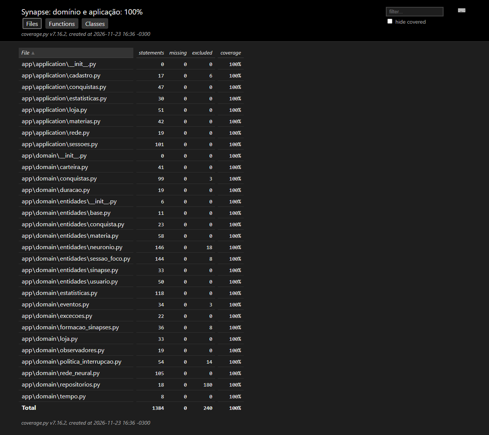
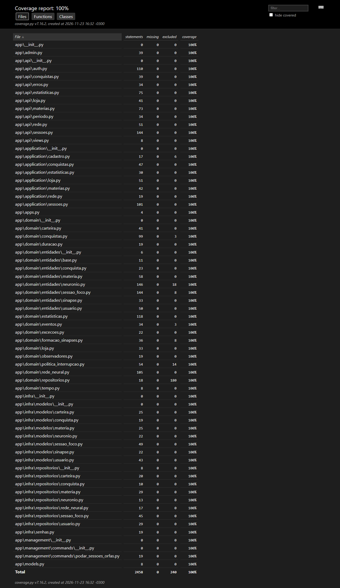
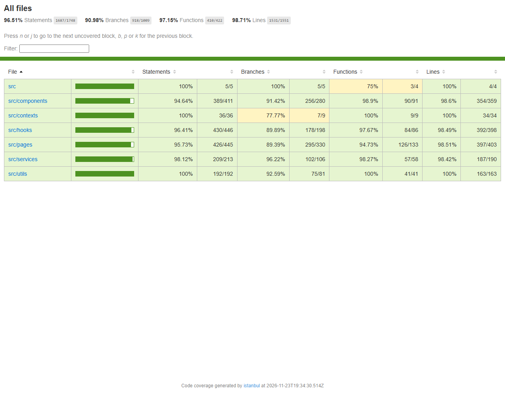
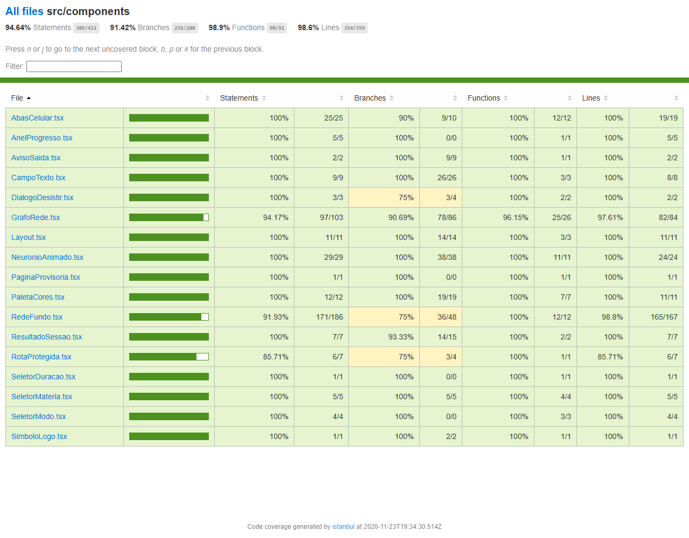

# Testes de Software

> Enunciado, seção 2.5.3: descrever a estratégia de testes adotada, as ferramentas utilizadas, o que foi coberto e o que ficou fora do escopo, e apresentar evidências de execução.

O Synapse tem 1137 testes automatizados: 756 no backend e 381 no frontend. Todos rodam no CI a cada push e pull request, e o CI falha se a cobertura de `app/domain` e `app/application` (backend) ou de qualquer métrica do frontend ficar abaixo de 80%. Na versão 1.0.0, a cobertura é de 100% no backend inteiro e de 96,51% das instruções no frontend.

## Estratégia

Cada regra é testada no nível mais baixo em que ela existe. As regras de negócio ficam no domínio, que não importa o Django, então são testadas como objetos Python comuns, sem banco. O que só existe com o Django e o PostgreSQL (rotas, autenticação, formato das respostas, consultas ao banco, migrações) é testado na integração. No frontend, a lógica de estado fica nos hooks e nas funções puras, e as telas são testadas como o estudante as usa, com a API simulada.

| Nível | Onde | Ferramentas | O que entra | Por que nesse nível |
|---|---|---|---|---|
| Unitário | `backend/tests/unit/` | pytest, repositórios em memória, relógio controlado | Entidades, regras e serviços de aplicação | O domínio não depende de framework, então cada regra roda isolada e rápido: 482 testes em menos de 1 s |
| Integração | `backend/tests/integration/` | pytest-django, `APIClient` do DRF, PostgreSQL 16 | Endpoints, repositórios Django, modelos, migrações, Admin e CORS | São as partes que só funcionam com o Django e o banco de verdade: 274 testes em cerca de 18 s |
| Componentes, telas e hooks | `frontend/src/**/*.test.ts(x)` | Vitest, Testing Library, jsdom, servidor falso | Telas, componentes, hooks, serviços HTTP, funções puras e o service worker | O comportamento da interface depende do navegador simulado, não do backend; o contrato da API já é testado na integração |

A mesma regra pode aparecer em mais de um nível, cada um testando a sua parte. A seção [Exemplo: uma regra nos três níveis](#exemplo-uma-regra-nos-três-níveis) mostra a poda antes de 5 minutos.

Para conferir que os testes pegam erros de verdade, nas issues #20, #25, #26, #32 e #34 cada regra principal foi quebrada de propósito no código, e um teste falhou em cada caso. Depois a regra foi restaurada.

Os testes de aceitação não ficam numa pasta à parte: cada critério de aceite das issues virou um teste no nível em que a regra está, com o nome começando por "critério" (`test_criterio_...` no backend, `it('critério: ...')` no frontend). São 54: 39 no backend, em 12 arquivos (ex.: `test_criterio_sessao_de_duas_horas_sem_poda`), e 15 nas telas e no service worker do frontend, em 7 arquivos.

### Testes unitários (backend)

Os testes do domínio criam as entidades direto, sem Django, e conferem valores válidos e inválidos (com `pytest.mark.parametrize`), invariantes e eventos. Os testes dos serviços usam repositórios em memória (`backend/tests/repositorios.py`), que implementam as mesmas interfaces de `app/domain/repositorios.py`, e um relógio controlado pelo teste (o parâmetro `relogio` do `SessaoService`). Assim dá para testar a sessão concluída 1 segundo antes da hora ou podada aos 4:59 sem esperar e sem banco.

- **Domínio** (`backend/tests/unit/domain/`, issues #9 e #22): um arquivo por classe (`Usuario`, `SessaoFoco`, `Neuronio`, `Duracao` e as exceções). Cobrem valores válidos e inválidos, atributos somente leitura e igualdade por identidade. Em `test_neuronio.py` (issue #22), cobrem também a classe abstrata `TipoNeuronio`, os atributos visuais de `Granular`, `Piramidal` e `Purkinje`, a `FabricaNeuronio` em todas as faixas de duração (incluindo os limites de 10, 20, 24, 25, 55, 59, 60 e 120 minutos) e o critério de aceite de adicionar um novo tipo sem alterar quem chama a fábrica.
- **Arquitetura** (`backend/tests/unit/domain/test_dominio_puro.py`, issue #9): lê os imports de cada arquivo de `app/domain/` com o módulo `ast` e falha se algum importar `django` ou `rest_framework`. É o teste que garante que o domínio continua testável sem banco.
- **Diagrama de classes** (`backend/tests/unit/test_diagrama_classes.py`, issue #40): lê as classes do código pela árvore sintática e as do diagrama pelo texto do PlantUML (`docs/uml/classes.puml`), e falha se uma classe, um método ou um atributo for criado, renomeado ou apagado sem atualizar o diagrama.
- **Rede neural** (`backend/tests/unit/domain/test_rede_neural.py` e `test_sinapse.py`, issue #23): a regra de formação é testada neurônio a neurônio (os 2 mais recentes, o último da mesma matéria mesmo que antigo, o peso que cresce a cada volta à matéria até o máximo, uma sinapse só quando os dois motivos coincidem, neurônios mortos ignorados). As invariantes do agregado são testadas com regras falsas que propõem ligações inválidas (repetidas, autoconexão, neurônio morto ou fora da rede), confirmando que a rede recusa e fica como estava. Em `backend/tests/unit/application/test_sessoes.py`, os cinco caminhos de poda (saída no estrito, saldo esgotado no tolerante, desistência, abandono percebido ao acessar e na varredura) deixam um neurônio morto sem sinapses, e uma regra trocada no `RedeNeuralService` vale sem mudar o `SessaoService`.
- **Serviço de sessões** (`backend/tests/unit/application/test_sessoes.py`, issue #16): o `SessaoService` com repositórios em memória e o relógio controlado. Cobre uma sessão ativa por usuário, conclusão antes da hora (recusada) e dentro da tolerância de 2 s, criação do neurônio, poda por saída nos dois modos, saídas no futuro ou antes do início (recusadas), sessão de outro usuário e a expiração de sessões abandonadas.
- **Histórico de sessões** (`backend/tests/unit/application/test_sessoes.py`, issue #29): o caso de uso `historico`: ordem da mais recente para a mais antiga, filtros de resultado e de período, as páginas e o total, a separação entre estudantes, a sessão abandonada que é podada antes de listar e a página ou o tamanho menor que 1 recusados.
- **Cadastro e matérias** (`backend/tests/unit/application/test_cadastro.py` e `test_materias.py`): o cadastro normaliza o e-mail, recusa e-mail repetido sem diferenciar maiúsculas e não salva nada quando a senha é inválida. O serviço de matérias recusa nome repetido para o mesmo estudante (e aceita para estudantes diferentes), lista em ordem de nome e não deixa um estudante buscar, editar ou remover a matéria de outro.
- **Regras de conquista e sequência de dias** (`backend/tests/unit/domain/test_conquistas.py`, issue #32): a sequência é testada dia a dia (sem sessões, só hoje, ontem ainda valendo, um dia inteiro sem sessão zerando a atual e mantendo o recorde, várias sessões no mesmo dia, ordem qualquer), assim como o resumo tirado da rede (só neurônios vivos contam) e a contagem dos dias no horário de Brasília (uma sessão às 22h não vira o dia seguinte, como seria em UTC). Cada regra do catálogo é conferida um ponto abaixo da meta e na meta, com o progresso parando na meta; os testes também cobrem a regra com meta configurável, uma conquista nova escrita como subclasse e a subclasse sem `medir`, que não pode ser criada.
- **Serviço e observador de conquistas** (`backend/tests/unit/application/test_conquistas.py`, issue #32): o `ConquistaService` desbloqueia cada conquista uma vez só, com a data informada; sessões podadas não contam; a consulta traz bloqueadas e desbloqueadas com o progresso e desbloqueia o que já estava cumprido (quem focava antes de as conquistas existirem). Montado como na API, o `SessaoService` com o `AvaliadorConquistas` desbloqueia "primeiro neurônio", "7 dias seguidos" e "100 sinapses" (na 52ª sessão, quando a rede passa de 99 para 101 sinapses) ao concluir, e um teste inscreve o avaliador antes do atualizador da rede para mostrar por que a ordem importa.
- **Loja e carteira de ATP** (`backend/tests/unit/domain/test_loja.py`, `test_carteira.py` e `backend/tests/unit/application/test_loja.py`, issue #34): o catálogo tem as 8 cores gratuitas do design e 12 exclusivas, que não repetem nenhuma cor da paleta, dos tipos de neurônio nem da poda, e as cores com efeito custam mais que as lisas. A carteira é testada regra a regra: ATP proporcional à duração, compra que desconta e desbloqueia, saldo exato, saldo insuficiente (com quanto falta, sem mudar nada), compra repetida, cor gratuita que não se compra. No serviço, a matéria só aceita cor gratuita ou comprada (ao criar e ao trocar a cor, sem mudar nada quando recusa), uma cor antiga de fora da paleta continua ao editar só o nome, e o `SessaoService` com o `CreditadorATP` credita o ATP ao concluir, e não na poda.
- **Cálculo e serviço de estatísticas** (`backend/tests/unit/domain/test_estatisticas.py` e `backend/tests/unit/application/test_estatisticas.py`, issue #30): a função pura `calcular_estatisticas` é testada em todos os períodos (`dia`, `semana` e `mes`), incluindo pontas do intervalo e virada de dia no fuso de Brasília (`UTC-3`). Cobre o estado vazio (zeros e todos os dias do período preenchidos), o tempo total focado, por dia e por matéria (com cor, efeito da loja, sessões sem matéria e matérias sem foco omitidas, ignorando sessões podadas e em andamento), a taxa de sucesso (`concluídas / total`, sem penalizar sessão ainda em andamento) e o melhor horário do dia (soma de minutos por hora de início no fuso de Brasília, desempate por quantidade de sessões e depois pela hora mais cedo). O `EstatisticasService` confere o isolamento entre estudantes e a poda automática de sessão abandonada antes da consulta.
- **Repositórios em memória** (`backend/tests/unit/test_repositorios_memoria.py`): os dublês usados pelos testes dos serviços implementam as interfaces do domínio e guardam e devolvem o que recebem. Se uma interface mudar e o dublê não, esses testes falham antes dos testes dos serviços darem um resultado enganoso.

### Testes de integração (backend)

Os testes de integração usam o `APIClient` do DRF contra o PostgreSQL, o mesmo banco da produção. O pytest-django cria um banco separado (`test_synapse`) e o apaga no fim, e `backend/tests/integration/test_banco.py` confere que é mesmo PostgreSQL e que não há migração pendente. Quando a regra depende da hora, o relógio da API é trocado com `monkeypatch` (por exemplo, em `app.api.sessoes.agora`). Os limites de consultas ao banco são conferidos com `django_assert_max_num_queries`, que falha se uma mudança criar consultas a mais.

- **Autenticação** (`backend/tests/integration/test_auth_cadastro.py`, `test_auth_login.py`, `test_auth_me.py` e `test_auth_renovar.py`): cadastro (sucesso, e-mail repetido, campos inválidos, senha fraca), login (e-mail sem diferenciar maiúsculas, senha errada, usuário inexistente ou inativo), a rota `/me` com token válido, ausente, inválido, expirado ou malformado, e a renovação do token, incluindo a rotação que devolve um novo token de renovação. O Swagger documenta a autenticação Bearer.
- **API de sessões** (`backend/tests/integration/test_api_sessoes.py`, issue #16): os critérios de aceite da issue (concluir antes da hora retorna 409; sessão de outro usuário retorna 404) e o histórico de interrupções do modo tolerante que sobrevive entre requisições. Na issue #20, também que reenviar a mesma interrupção (o app tenta de novo quando a rede falha) não desconta o saldo duas vezes. O comando `podar_sessoes_orfas` é executado com `call_command` e poda a sessão abandonada.
- **Persistência da rede neural** (`backend/tests/integration/test_repositorios_django.py`, classe `TestRepositorioRedeNeuralDjango`, e `test_api_sessoes.py`, issue #23): a rede vai ao banco e volta igual; gravar de novo só insere o que é novo; a rede é carregada em duas consultas; e as restrições do banco recusam sinapse repetida, autoconexão e peso zero mesmo sem passar pelo domínio. Pela API, sessões concluídas formam sinapses, sessões podadas (nos dois modos e por abandono) deixam neurônios mortos sem sinapses, e redes de estudantes diferentes não se misturam.
- **Endpoint da rede neural** (`backend/tests/integration/test_api_rede.py`, issue #25): o formato do grafo campo a campo (tipo e cor por faixa de duração, neurônio podado sempre cinza, sinapses com peso), a rede vazia, a autenticação obrigatória, a separação entre estudantes, cada filtro sozinho e combinado (incluindo data e hora com fuso de Brasília), os filtros inválidos (400 com o campo em `detalhes`) e o Swagger. O critério de aceite é testado com 500 neurônios: a resposta precisa vir em menos de 300 ms e em no máximo 2 consultas ao banco (cerca de 35 ms medidos no PostgreSQL; cerca de 75 ms pelo HTTP com autenticação JWT, no servidor de desenvolvimento).
- **Endpoint do histórico** (`backend/tests/integration/test_api_historico.py`, issue #29): `GET /sessoes` com a lista paginada (`total`, `pagina`, `tamanho` e `paginas`), cada filtro (`status`, `de` e `ate`) sozinho e combinado, a autenticação obrigatória, a separação entre estudantes, a sessão abandonada que aparece como podada, os filtros inválidos, o `POST /sessoes` que continua no mesmo endereço e o Swagger. Um teste limita as consultas ao banco a 6 por página, com 15 sessões com interrupções: sem o `prefetch_related`, seriam 21, e o teste falha.
- **Endpoint de conquistas** (`backend/tests/integration/test_api_conquistas.py` e `test_repositorios_django.py`, classe `TestRepositorioConquistaDjango`, issue #32): `GET /conquistas` com todas as conquistas, bloqueadas e desbloqueadas, cada uma desbloqueada pelo caminho real (sessões concluídas pela API, com a data igual ao fim da sessão), a sequência subindo dia a dia e zerando depois de um dia sem sessão, a sessão podada que não conta, os dias de Brasília, a separação entre estudantes, o desbloqueio retroativo, a autenticação obrigatória, o limite de 5 consultas e o Swagger. O banco recusa a mesma conquista duas vezes para o estudante.
- **Endpoint da loja** (`backend/tests/integration/test_api_loja.py` e `test_repositorios_django.py`, classe `TestRepositorioCarteiraDjango`, issue #34): pelo caminho real, o ATP proporcional à duração, a sessão podada que não rende, a compra que valida o saldo (409 com quanto falta, nada gravado) e desconta, a compra repetida, a cor fora da loja (404) e a separação entre estudantes. Nas matérias, a cor bloqueada (409) e a de fora da paleta (422); a cor com efeito vai para a matéria e para a rede. Também o limite de 10 consultas na compra, a migração 0007 (crédito de quem já tinha sessões), a 0008 (volta o banco para a 0007, cria compras da loja anterior e confere o reembolso ao migrar de novo) e o Swagger.
- **Endpoint de estatísticas** (`backend/tests/integration/test_api_estatisticas.py`, issue #30): `GET /estatisticas?periodo=dia|semana|mes` com a autenticação obrigatória (401), o período padrão (`semana`), o parâmetro inválido (400 com `detalhes.periodo`), os valores calculados pelo fluxo real de criação, conclusão e desistência de sessões, a separação entre estudantes, a sessão abandonada que é podada ao consultar, o limite de 6 consultas e o Swagger.
- **Matérias** (`backend/tests/integration/test_api_materias.py` e `test_sessao_com_materia.py`): criar, listar, editar e remover matérias pela API, com os erros de cada caso (nome inválido ou repetido, cor fora do formato, matéria de outro estudante com 404), e a sessão associada a uma matéria: concluir cria o neurônio com a matéria, desistir cria o neurônio podado com ela, e remover a matéria deixa as sessões e os neurônios sem matéria, sem apagá-los.
- **Modelos, Admin e configuração** (`backend/tests/integration/test_usuario_model.py`, `test_sessao_foco_model.py`, `test_materia_model.py`, `test_modelos_str.py`, `test_admin.py`, `test_cors.py`, `test_health.py` e `test_api_erros.py`): os modelos (e-mail único e senha guardada como hash, nome de matéria único por estudante sem diferenciar maiúsculas, exclusão em cascata e conversão entre model e entidade do domínio), o texto de cada registro no Admin, o Admin exigindo login e abrindo usuários e sessões, o `createsuperuser`, o CORS liberado só para as origens do frontend (desenvolvimento e build de produção), a rota de saúde e o tratamento de erros: permissão negada (403), outros erros do DRF (405) e erro inesperado (500), que não mostra o detalhe ao cliente e só o registra no log.

### Testes de componentes, telas e hooks (frontend)

O frontend roda no jsdom, um navegador simulado. Os hooks são testados isolados com `renderHook`, e o relógio falso do Vitest (`vi.useFakeTimers`) faz o tempo passar sem esperar. As telas são testadas com a Testing Library como o estudante as usa: o `user-event` clica e digita, e os elementos são buscados pelo papel acessível (`getByRole`), o que também confere a acessibilidade. A API é simulada (um `fetch` falso, funções dos serviços trocadas com `vi.spyOn` ou o servidor falso de `frontend/src/test/servidorFalso.ts`), porque o objetivo é testar a interface e as respostas da API já são testadas no backend. As funções puras (`frontend/src/utils/`) têm testes unitários simples.

- **Login, cadastro e sessão do usuário** (`frontend/src/pages/Login.test.tsx`, `Cadastro.test.tsx`, `frontend/src/hooks/useAuth.test.tsx`, `frontend/src/contexts/AuthContext.test.tsx`, `frontend/src/services/api.test.ts` e `auth.test.ts`): a validação dos campos antes de enviar, as mensagens de erro da API e da falta de rede, a sessão salva que sobrevive ao recarregar a página (e o `localStorage` corrompido, que não quebra nada) e a renovação automática do token: com o token expirado, a chamada é repetida com o token novo; chamadas simultâneas compartilham uma renovação só; se não der para renovar, a sessão é encerrada.
- **Rotas** (`frontend/src/App.test.tsx`): quem não está logado vai para `/login`, quem está logado vai para a tela de foco, o menu navega entre as telas protegidas, o botão Sair desloga e um endereço inexistente mostra a página de erro.
- **Timer da sessão de foco** (`frontend/src/hooks/useSessaoFoco.test.ts`, issue #17): inclui o critério de aceite da issue: o relógio avança sem o intervalo disparar, como numa aba em segundo plano, e o tempo restante continua certo ao voltar para a aba. Também cobre a regra do modo tolerante: saldo de 10% da sessão para ficar fora da tela, descontado a cada saída sem voltar ao valor inicial, e poda quando a saída passa do saldo.
- **Detecção de saída da tela** (`frontend/src/hooks/useDeteccaoSaida.test.ts`, issue #18): como o jsdom não troca de aba nem entra em tela cheia, os testes simulam o que o navegador informa (`visibilityState`, `fullscreenElement`, `hasFocus`) e disparam os eventos. Cobrem cada sinal, a junção de sinais simultâneos numa saída só (trocar de aba dispara `blur` e `visibilitychange`), o caso do iPhone sem tela cheia e o aviso nativo ao fechar a página.
- **Tela de foco** (`frontend/src/pages/Foco.test.tsx`, issues #17 e #18): escolher duração e modo, começar, desistir com confirmação, ver as telas de sucesso e de poda. O bloco "saída da tela" verifica os critérios de aceite da #18: trocar de aba no modo estrito poda a sessão; no modo tolerante, saídas somando até 10% da sessão mantêm a sessão viva, com o saldo restante na tela, e passar disso poda.
- **Tela de foco com o servidor falso** (`frontend/src/hooks/useSessaoFoco.test.ts`, `frontend/src/services/sessoes.test.ts` e `frontend/src/pages/Foco.test.tsx`, issue #20): o servidor falso tem as mesmas regras da API (uma sessão ativa por vez, poda no estrito, saldo de 10% no tolerante, conclusão só no fim previsto) e guarda as chamadas recebidas. Cobre os critérios de aceite da issue (iniciar → concluir cria o neurônio no servidor; a poda funciona nos dois modos) e os casos de falha: sem rede, o aviso de saída fica guardado e é entregue antes da próxima sessão ou ao reabrir a tela, e a conclusão é tentada de novo; se o servidor podar, a tela mostra a poda; o relógio do navegador atrasado não atrapalha.
- **Neurônio animado** (`frontend/src/utils/geometriaNeuronio.test.ts` e `frontend/src/components/NeuronioAnimado.test.tsx`, issue #19): a geometria é testada como função pura (o desenho é sempre o mesmo para o mesmo tipo; o corpo celular cresce primeiro, os dendritos nível a nível e o axônio só depois de 80%; podado, recolhe até 42%, sem axônio nem pontas). No componente, verifica que a poda e o brilho forte só entram depois do primeiro quadro, para a transição acontecer na tela.
- **Tela da rede neural** (`frontend/src/pages/Rede.test.tsx`, `frontend/src/utils/redeNeural.test.ts` e `frontend/src/services/rede.test.ts`, issue #26): o resumo e a descrição para leitores de tela; cada neurônio com o tamanho do tipo, a cor da matéria e os dendritos, e o podado só com o contorno; o neurônio mais recente aceso ao abrir; tocar ou passar o mouse num neurônio acende ele, as sinapses dele e propaga o brilho aos vizinhos e aos vizinhos deles; a dica com matéria, duração, tipo e data; os filtros de matéria e de período chegando à API; o estado vazio; o filtro sem resultado; e a falha de rede com nova tentativa. O layout é sempre o mesmo para a mesma rede, fica dentro do `viewBox` e deixa neurônios ligados mais perto que a média.
- **Tela do histórico** (`frontend/src/pages/Historico.test.tsx`, `frontend/src/utils/historico.test.ts` e `frontend/src/services/sessoes.test.ts`, issue #29): com uma API simulada que filtra e pagina como a de verdade, cada sessão com data, hora, duração, matéria e resultado, agrupadas por dia; a cor da matéria, a do tipo e o cinza da podada; os filtros chegando à API; o "Carregar mais" até a última página (sem repetir a sessão que uma nova empurrou para a página seguinte); o histórico vazio, o filtro sem resultado e a falha de rede. As datas dos testes são montadas no fuso do navegador, então eles passam em qualquer fuso.
- **Conquistas e estatísticas** (`frontend/src/pages/Conquistas.test.tsx`, `frontend/src/hooks/useConquistas.test.ts` e `frontend/src/pages/Estatisticas.test.tsx`): as conquistas desbloqueadas com selo e data, as bloqueadas em cinza com dica e barra de progresso, a contagem e a sequência de dias. Nas estatísticas, o total de horas, a taxa de sucesso e a sequência, o seletor de período trocando os dados, o tempo por matéria com a cor de cada uma, o período vazio e a falta de conexão com nova tentativa.
- **Matérias** (`frontend/src/pages/Materias.test.tsx`, `frontend/src/hooks/useMaterias.test.ts` e `frontend/src/components/SeletorMateria.test.tsx`): a lista, o estado vazio, criar e editar escolhendo nome e cor, excluir com confirmação, cancelar a edição ou a exclusão e o erro de nome repetido. No hook (issue #43), recarregar a lista e cada erro do servidor ao criar, editar e excluir viram a mensagem certa, sem mudar a lista. O seletor de matéria marca a escolhida ou "Sem matéria", avisa a tela a cada troca e pode ser desabilitado.
- **Tela da loja e cores com efeito** (`frontend/src/pages/Loja.test.tsx`, `Materias.test.tsx`, `NeuronioAnimado.test.tsx`, `Rede.test.tsx`, `Historico.test.tsx` e `Foco.test.tsx`, issue #34): na loja, só as cores à venda (exclusivas e com efeito, em seções separadas), a prévia com a cor e o efeito, a compra com confirmação que manda para Matérias, o "Faltam X ATP", a recusa do servidor com o motivo e a falta de rede. Na paleta das matérias, as não compradas bloqueadas e com o preço, e as 8 gratuitas quando a loja não carrega. O efeito aparece no neurônio que cresce e no de sucesso (com o "+25 ATP"), nos neurônios da rede (com a aura) e nas bolinhas do histórico e dos filtros; neurônios podados e sessões sem matéria ficam sem efeito.
- **Fundo animado** (`frontend/src/components/RedeFundo.test.tsx`, issue #43): o fundo das telas de login e cadastro é testado com um contexto 2D falso, que registra o que seria desenhado, e com os quadros da animação rodados um a um: os neurônios e as sinapses aparecem, o cursor perto acende as sinapses, a aba escondida pausa a animação, o número de neurônios acompanha o tamanho da tela e, ao sair, a animação para e os eventos são soltos.
- **Celular e PWA** (`frontend/src/hooks/useTelaLigada.test.ts`, `frontend/src/sw.test.ts`, `frontend/src/registrarServiceWorker.test.ts`, `frontend/src/App.test.tsx`, `frontend/src/pages/Foco.test.tsx` e `frontend/src/hooks/useDeteccaoSaida.test.ts`, issue #35): a trava de tela é pedida só durante a sessão, pedida de novo ao voltar para a página, solta ao terminar, e a recusa ou a falta de suporte não quebram nada. O service worker de verdade (`frontend/public/sw.js`) roda com `caches` e `fetch` falsos: guarda na instalação a casca e os arquivos que o `index.html` usa, apaga caches de outras versões, sem rede abre a página com o JS, o CSS e as fontes guardados (o cache falso respeita o `Vary: Origin` como o navegador, e o teste falha se o service worker não o ignorar), e deixa a API e os envios de fora. No celular, a navegação é a barra de abas e "Mais" abre Matérias, Conquistas, Loja e Sair; trocar de app ou bloquear a tela conta como saída.

### Exemplo: uma regra nos três níveis

A sessão podada com menos de 5 minutos de foco é apagada e não entra no histórico nem na rede. Cada nível testa uma parte dessa regra:

- **Domínio** (`backend/tests/unit/domain/test_sessao_foco.py`): a sessão podada aos 4:59 é curta demais e aos 5:00 não, contando no tolerante até o instante em que o saldo acabou; em andamento ou concluída, nunca.
- **Serviço** (`backend/tests/unit/application/test_sessoes.py`): desistência, saída no estrito e saldo esgotado no tolerante aos 4:59 apagam a sessão sem publicar evento (histórico e rede vazios) e, aos 5:00, a sessão fica com o neurônio morto; depois da poda curta, outra sessão pode começar.
- **API** (`backend/tests/integration/test_api_sessoes.py`): a resposta ainda é a sessão podada, mas a linha, as saídas e o neurônio não ficam no banco, e um aviso de saída repetido recebe 404.
- **Tela** (`frontend/src/pages/Foco.test.tsx`): o diálogo de desistência e a tela de poda avisam que a sessão não fica no histórico e escondem o link para ele.

### Integração contínua

O CI (`.github/workflows/ci.yml`, GitHub Actions) roda a cada push na `main` e em cada pull request, em três jobs:

| Job | Passos |
|---|---|
| `backend` | ruff, `manage.py check`, checagem de migrações pendentes, pytest com cobertura num PostgreSQL 16, meta de 80% em `app/domain` e `app/application` e o relatório HTML como artefato (`coverage-html`) |
| `frontend` | ESLint, Vitest com cobertura e meta de 80% em instruções, ramos, funções e linhas, o relatório HTML como artefato (`coverage-html-frontend`) e o build de produção |
| `imagem-producao` | Build da imagem usada no deploy e `manage.py check --deploy` com `DEBUG=False` |

## Ferramentas

| Ferramenta | Versão | Para que serve |
|---|---|---|
| pytest | 9.1.1 | Executa os testes do backend; `pytest.mark.parametrize` para os casos de limite |
| pytest-django | 4.14.0 | Cria e apaga o banco de teste, libera o banco por teste (`django_db`) e conta as consultas (`django_assert_max_num_queries`) |
| pytest-cov / coverage.py | 7.1.0 / 7.16.2 | Cobertura do backend e relatório HTML |
| `APIClient` do Django REST Framework | 3.18.1 | Faz as requisições HTTP nos testes de integração, com autenticação JWT |
| PostgreSQL | 16 | O mesmo banco da produção, no Docker (local) e como serviço no CI |
| Repositórios em memória | `backend/tests/repositorios.py` | Dublês das interfaces do domínio para testar os serviços sem banco |
| ruff | 0.16.10 | Lint do backend no CI |
| Vitest | 5.0.3 | Executa os testes do frontend; `vi.fn`, `vi.spyOn` e o relógio falso (`vi.useFakeTimers`) |
| jsdom | 30.1.1 | Navegador simulado onde as telas são montadas |
| Testing Library (React, user-event, jest-dom) | 16.3.3, 14.6.7, 7.0.1 | Monta as telas, simula o estudante (cliques, digitação) e busca os elementos pelo papel acessível |
| @vitest/coverage-v8 | 5.0.3 | Cobertura do frontend, com a meta de 80% na configuração (`frontend/vite.config.ts`) |
| Servidor falso | `frontend/src/test/servidorFalso.ts` | Imita a API de sessões, com as mesmas regras, e guarda as chamadas recebidas |
| ESLint | 10.11.0 | Lint do frontend no CI |
| GitHub Actions | `.github/workflows/ci.yml` | Roda tudo a cada push e pull request e guarda os relatórios de cobertura |

## O que foi coberto

### Quantidade de testes

Backend, 756 testes:

| Nível | Pasta | Arquivos | Testes |
|---|---|---:|---:|
| Unitário: domínio | `backend/tests/unit/domain/` | 15 | 350 |
| Unitário: aplicação (serviços) | `backend/tests/unit/application/` | 7 | 117 |
| Unitário: diagrama e repositórios em memória | `backend/tests/unit/` | 2 | 15 |
| Integração: API (endpoints, autenticação, CORS, saúde) | `backend/tests/integration/` | 14 | 198 |
| Integração: repositórios Django, modelos, Admin e banco | `backend/tests/integration/` | 8 | 76 |

Frontend, 381 testes em 36 arquivos:

| Pasta | O que tem | Arquivos | Testes |
|---|---|---:|---:|
| `frontend/src/pages/` | Telas | 9 | 107 |
| `frontend/src/hooks/` | Hooks (timer, saída da tela, autenticação, matérias, conquistas, tela ligada) | 6 | 96 |
| `frontend/src/utils/` | Funções puras (tipo e geometria do neurônio, layout da rede, histórico, senha, tempo) | 6 | 63 |
| `frontend/src/services/` | Chamadas à API | 7 | 52 |
| `frontend/src/components/` | Componentes | 4 | 28 |
| `frontend/src/` (raiz) | Rotas, service worker e registro dele | 3 | 33 |
| `frontend/src/contexts/` | Renovação do token | 1 | 2 |

### Cobertura por camada

Backend (instruções; as migrações e os métodos abstratos ficam fora da conta):

| Camada | Instruções | Sem cobertura | Cobertura |
|---|---:|---:|---:|
| `app/domain` | 1077 | 0 | **100%** |
| `app/application` | 307 | 0 | **100%** |
| `app/infra` | 395 | 0 | **100%** |
| `app/api` | 609 | 0 | **100%** |
| Outros (`admin.py`, `apps.py`, `models.py`, comando de poda) | 70 | 0 | **100%** |
| **Total** | **2458** | **0** | **100%** |

Frontend (sem os próprios testes, o servidor falso, o `setupTests.ts` e o `main.tsx`):

| Pasta | Instruções | Ramos | Funções | Linhas |
|---|---:|---:|---:|---:|
| `src/components` | 94,64% (389/411) | 91,42% | 98,90% | 98,60% |
| `src/contexts` | 100% (36/36) | 77,77% | 100% | 100% |
| `src/hooks` | 96,41% (430/446) | 89,89% | 97,67% | 98,49% |
| `src/pages` | 95,73% (426/445) | 89,39% | 94,73% | 98,51% |
| `src/services` | 98,12% (209/213) | 96,22% | 98,27% | 98,42% |
| `src/utils` | 100% (192/192) | 92,59% | 100% | 100% |
| `src` (raiz) | 100% (5/5) | 100% | 75% | 100% |
| **Total** | **96,51% (1687/1748)** | **90,98%** | **97,15%** | **98,71%** |

O que falta no frontend são poucas linhas e ramos espalhados que o jsdom não consegue provocar, como o `canvas` sem contexto 2D. A lista linha a linha está no relatório HTML.

### Por funcionalidade

| Funcionalidade | Unitário (backend) | Integração (backend) | Frontend |
|---|---|---|---|
| Cadastro, login e token | `test_usuario.py`, `test_cadastro.py` | `test_auth_*.py` | `Login`, `Cadastro`, `useAuth`, `AuthContext`, `api`, `auth`, `App` |
| Sessão de foco e poda | `test_sessao_foco.py`, `test_politica_interrupcao.py`, `test_duracao.py`, `test_sessoes.py` | `test_api_sessoes.py`, `test_sessao_foco_model.py` | `useSessaoFoco`, `useDeteccaoSaida`, `Foco`, `sessoes` |
| Rede neural | `test_neuronio.py`, `test_sinapse.py`, `test_rede_neural.py`, `test_rede.py` | `test_api_rede.py`, `test_repositorios_django.py` | `Rede`, `redeNeural`, `NeuronioAnimado`, `geometriaNeuronio` |
| Histórico | `test_sessoes.py` | `test_api_historico.py` | `Historico`, `historico` |
| Estatísticas | `test_estatisticas.py` (domínio e serviço) | `test_api_estatisticas.py` | `Estatisticas` |
| Conquistas | `test_conquistas.py` (domínio e serviço) | `test_api_conquistas.py` | `Conquistas`, `useConquistas`, `conquistas` |
| Matérias | `test_materia.py`, `test_materias.py` | `test_api_materias.py`, `test_sessao_com_materia.py`, `test_materia_model.py` | `Materias`, `useMaterias`, `SeletorMateria` |
| Loja e ATP | `test_loja.py` (domínio e serviço), `test_carteira.py` | `test_api_loja.py` | `Loja`, `loja` |
| Celular e PWA | | `test_cors.py` | `useTelaLigada`, `sw`, `registrarServiceWorker`, `App` |
| Administração e varredura | | `test_admin.py`, `test_modelos_str.py`, `test_api_sessoes.py` (comando `podar_sessoes_orfas`) | |

## O que ficou fora do escopo

- **Aparência e fluidez das animações** (issue #19): o jsdom não desenha nem roda transições CSS, então os testes automatizados conferem os valores (quanto de cada traço está desenhado, classes de poda e de brilho), não o resultado visual. A comparação com o protótipo e a fluidez num celular real são verificadas manualmente.
- **Fluidez da rede neural** (issue #26): o jsdom não desenha, então a fluidez foi medida à mão no navegador, com redes de 300 e 500 neurônios: tempo entre quadros no zoom e no arrasto, custo de cada realce e tempo do cálculo das posições (os números estão em `docs/relatorios/boas-praticas.md`, seção Desempenho). A pinça e o arrasto com um dedo foram conferidos com eventos de toque numa tela de celular emulada; num celular de verdade, ficam para a verificação manual.
- **Comportamento de cada navegador ao sair da tela** (issue #18): os eventos são simulados nos testes, então as diferenças reais entre Chrome, Firefox, Android e iPhone (por exemplo, o iPhone não tem tela cheia para páginas, e celulares costumam ignorar o aviso de `beforeunload`) são verificadas manualmente e registradas na issue.
- **Instalação e tela ligada no aparelho** (issue #35): a instalação no Android, o uso no iPhone e a tela ligada num celular de verdade são verificados manualmente (passo a passo em `frontend/README.md`). Nos testes automáticos, o service worker e a trava de tela são exercitados com o navegador simulado; o layout foi conferido a 360 px em todas as telas.
- **Código gerado e contratos sem corpo**: as migrações, geradas pelo Django, e os métodos abstratos (`@abstractmethod`), que só definem o contrato das interfaces, ficam fora da conta de cobertura do backend. No frontend, ficam fora o `main.tsx`, que só monta a aplicação, e o servidor falso, que é código de teste. As migrações com dados (0007 e 0008) têm testes próprios em `backend/tests/integration/test_api_loja.py`.

## Evidências de execução

Medido em 23/11/2026, na `main` (commit `7e9e750`). O detalhamento e as lacunas preenchidas na issue #43 estão em [`evidencias/`](evidencias/README.md).

### Resumo do `pytest --cov`

Na pasta `backend`, com o PostgreSQL rodando (os trechos `...` são as linhas de cada arquivo, omitidas aqui):

```text
$ uv run pytest --cov=app --cov-report=html
...
Coverage HTML written to dir htmlcov
756 passed in 37.76s

$ uv run coverage report
...
TOTAL                                             2458      0   100%

$ uv run coverage report --include="app/domain/*,app/application/*" --fail-under=80
...
TOTAL                                  1384      0   100%
```

### Resumo do Vitest

Na pasta `frontend`:

```text
$ npm run test:coverage
 Test Files  36 passed (36)
      Tests  381 passed (381)
...
Statements   : 96.51% ( 1687/1748 )
Branches     : 90.98% ( 918/1009 )
Functions    : 97.15% ( 410/422 )
Lines        : 98.71% ( 1531/1551 )
```

### Prints do relatório HTML

**Backend, `app/domain` e `app/application`:**



**Backend, todos os arquivos:**



**Frontend, por pasta:**



**Frontend, componentes:**



### Execução no CI

[Execução 45249457364 do CI](https://github.com/LuMaPro/Synapse/actions/runs/45249457364), no push do commit `7e9e750` na `main`, em 23/11/2026: os jobs [`backend`](https://github.com/LuMaPro/Synapse/actions/runs/45249457364/job/137954915833), [`frontend`](https://github.com/LuMaPro/Synapse/actions/runs/45249457364/job/137954915273) e [`imagem-producao`](https://github.com/LuMaPro/Synapse/actions/runs/45249457364/job/137954915615) passaram. Os relatórios HTML de cobertura dessa execução estão nos artefatos `coverage-html` (backend) e `coverage-html-frontend`, disponíveis até 21/02/2027.

### Como reproduzir

Os comandos acima, mais os do [README principal](../../README.md#como-rodar-os-testes). Os relatórios HTML ficam em `backend/htmlcov/index.html` e `frontend/coverage/index.html`.
